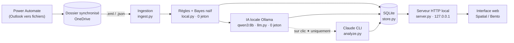

# Vigie Tour

> **Rien ne passe sans être vu.** Vos e-mails deviennent des tâches : à faire, à transférer, engagements, attentes, échéances. L'analyse se fait sur votre PC, sans envoyer un seul jeton à une IA par défaut.

**English summary.** Vigie Tour is a local, privacy-first Windows tool that turns your e-mails into a task list (to do, waiting for, commitments, deadlines). Mails reach a synced folder through Power Automate flows, then go through a *zero-token cascade*: regex rules + a naive Bayes classifier that learns from your own decisions, then a local LLM (Ollama, `qwen3:8b`), and Claude (CLI) **only when you click** a ✦ button. Everything is stored in a local SQLite database and served by a dependency-free Python web server (stdlib only). Try the **[interactive demo](#démo-interactive)** (static page, fictitious data, no server needed).

---

## Démo interactive

Une version 100 % statique de l'interface, avec des données fictives (agence événementielle « Nova Events »), tourne directement dans le navigateur, sans serveur :

**`https://<votre-compte>.github.io/vigie-tour/`** (à remplacer par votre URL GitHub Pages, voir [Mode démo](#mode-démo--github-pages))

Vous pouvez cocher des tâches, les reporter, changer leur priorité, lire les fils de discussion, lancer « ✦ Rédiger avec Claude » (réponse préparée), poser une question à la barre de commande (par exemple « reporte ce qui vient de Léa à jeudi ») ou cliquer sur Synchroniser pour voir arriver de nouveaux mails.

## Le problème

Une boîte mail professionnelle, c'est des centaines de messages, et très peu qui demandent vraiment quelque chose. Les demandes se perdent dans les fils, on oublie ce qu'on a promis (« je te l'envoie demain »), on ne relance pas ce qu'on attend des autres, et les rappels importants (une échéance, un document à valider) se noient dans le bruit.

Vigie Tour est une **tour de guet** posée sur la boîte mail : elle lit, trie et transforme chaque conversation en tâche claire, avec une échéance, une priorité, un plan d'action et une réponse prête à copier.

## Fonctionnalités

- **Cinq types de tâches** : à faire, à transférer (avec suggestion de la bonne personne grâce à l'annuaire « qui gère quoi »), engagements (ce que *vous* avez promis), en attente (relances à prévoir), à trier (pour info).
- **Échéances détectées** dans le texte (« avant vendredi », « fin de semaine », « 14/11 »), échéance estimée sinon, priorité calculée.
- **Zéro oubli** : une question directe restée sans réponse depuis 24 h devient automatiquement une tâche prioritaire.
- **Tickets de support** : un ticket = un fil, quel que soit son statut (« Waiting for reply: Customer », « Resolved »…). Les rapports automatiques récurrents (statistiques, notifications d'outils) sont regroupés en une tâche consolidée.
- **Apprentissage** : chaque « Fait », « Ignorer » ou reclassement affine le classifieur. Ce que vous avez réglé ne revient pas quand le fil est relu.
- **Lots** : les tâches de même nature (« Fiches intervenants », « Newsletters »…) sont regroupées pour être traitées en série.
- **Revue de l'historique** : les anciennes demandes reçues avant la mise en service sont à trier une seule fois, en quelques secondes, au clavier.
- **Barre de commande** (`Ctrl K`) : recherche en direct, ou demande en langage naturel (« qu'est-ce qui est urgent ? »). Les actions proposées ne sont jamais appliquées sans confirmation.
- **Réponses prêtes** : une réponse type pour chaque tâche, et un bouton « ✦ Rédiger avec Claude » à la demande.
- **Interface** : mise en page « application » (barre latérale et briefing fixes), blocs déplaçables et redimensionnables, thèmes **Spatial** et **Bento**, clair / sombre, décor « laboratoire » (pluie Matrix, console du moteur, globe) désactivable, raccourcis clavier (`J` `K` `X` `S` `C` `I` `R` `B`).

## Architecture



| Fichier | Rôle |
| --- | --- |
| `app/ingest.py` | Lit les `.eml` et `.json` déposés par Power Automate, nettoie les corps de mails (citations, signatures), regroupe les messages en fils, écarte le bruit (newsletters, formulaires, courrier indésirable). |
| `app/local.py` | Moteur sans IA : règles (demandes, engagements, échéances, tickets) et classifieur bayésien naïf appris sur vos décisions. Premier tri instantané. |
| `app/llm.py` | IA locale via [Ollama](https://ollama.com) (`qwen3:8b`) : relit en arrière-plan, un par un, les fils qui peuvent demander une action. Aucune donnée ne quitte le PC. |
| `app/analyze.py` | Claude (CLI) **uniquement à la demande** : analyse d'un fil, réponse rédigée, barre de commande. Mode « moteur » sans outils, quelques centaines de jetons par appel. |
| `app/store.py` | Base SQLite locale (messages, fils, tâches, recherche plein texte FTS5). |
| `app/server.py` | Serveur HTTP de la bibliothèque standard (API JSON + fichiers statiques), synchronisation en arrière-plan toutes les 60 s. |
| `app/journal.py` | Journal du moteur, affiché dans les terminaux du thème Spatial. |
| `app/launch.pyw` | Lanceur Windows : démarre le serveur s'il ne tourne pas, ouvre une fenêtre d'application Edge. |
| `app/static/` | Interface (HTML, CSS, JavaScript sans framework ni étape de build). |
| `docs/` | Démo statique (GitHub Pages) et documentation. |

## Approche zéro jeton et respect de la vie privée

- **Par défaut, aucun appel à une IA distante.** Les règles, le classifieur bayésien et l'IA locale (Ollama) tournent sur votre machine. Les mails restent dans votre dossier synchronisé et dans une base SQLite locale (`data/`, ignorée par git).
- **Claude est optionnel et à la demande.** Il n'est appelé que lorsque vous cliquez sur un bouton ✦ ou posez une question à la barre de commande, avec le modèle le plus économe (`haiku` par défaut) et sans outils : environ 150 jetons de surcharge par appel au lieu d'environ 19 000. Un tableau de consommation (appels, jetons lus et écrits sur 7 jours) est affiché dans les réglages.
- **Cascade** : chaque étage ne traite que ce que le précédent n'a pas su trancher. Les règles donnent un premier tri en quelques millisecondes ; l'IA locale confirme ou corrige en arrière-plan ; Claude n'intervient qu'à votre demande. Les tâches incertaines vont dans « À trier » plutôt que d'encombrer la liste.
- **Serveur local uniquement** : il écoute sur `127.0.0.1`, sans dépendance externe, sans télémétrie. La seule requête externe de l'interface est le chargement des polices Google Fonts (supprimez la balise `<link>` correspondante dans `index.html` pour un fonctionnement 100 % hors ligne).
- **Vos données d'identité** (nom, adresse, annuaire des collègues) vivent dans `config.local.json`, qui est ignoré par git.

## Installation et lancement

Le code est publié pour consultation (voir [LICENSE](LICENSE)) ; ces instructions décrivent le fonctionnement de l'outil.

Prérequis : **Windows 10/11** (le lanceur et l'ouverture d'un mail utilisent des API Windows ; le serveur lui-même est du Python portable) et **Python 3.12 ou plus récent**. Aucune dépendance à installer (`pip` inutile).

```bash
git clone https://github.com/<votre-compte>/vigie-tour.git
cd vigie-tour
copy config.example.json config.local.json   # puis adaptez-le (voir ci-dessous)
python app/server.py                          # ouvre http://127.0.0.1:8777
```

Sous Windows, double-cliquez sur `VigieTour.cmd` : le serveur démarre en arrière-plan et l'interface s'ouvre dans une fenêtre d'application Edge, sans barre d'adresse.

**Options (facultatives) :**

- **IA locale** : installez [Ollama](https://ollama.com) puis `ollama pull qwen3:8b`. Vigie Tour démarre `ollama serve` tout seul si besoin. Sans Ollama, les règles et le classifieur travaillent seuls.
- **Claude** : installez la [CLI Claude](https://docs.claude.com/en/docs/claude-code) et connectez-vous une fois (`claude`, puis `/login`). Seuls les boutons ✦ et la barre de commande en ont besoin.
- **Premiers mails** : sans flux Power Automate, créez le dossier `~/VigieTour/inbox/arrivee/` (dans votre dossier utilisateur) et déposez-y des fichiers `.eml` : ils sont lus à la minute suivante.

## Configuration

Copiez `config.example.json` en `config.local.json` (ignoré par git) :

```json
{
  "me": {
    "name": "Alex Martin",
    "email": "alex.martin@example.com",
    "role": "Webmaster chez Nova Events (sites événementiels, newsletters, WordPress)"
  },
  "inbox_dir": "~/VigieTour/inbox",
  "claude_model": "haiku",
  "port": 8777,
  "people": [
    { "nom": "Léa Martin", "email": "lea.martin@example.com", "role": "Head of Digital",
      "sujets": "arbitrages web, sites, plugins, priorités de l'équipe digitale" }
  ]
}
```

| Clé | Variable d'environnement | Rôle |
| --- | --- | --- |
| `me.name`, `me.email`, `me.role` | | Votre identité, utilisée par les règles et les consignes de l'IA. Les adresses du même domaine que `me.email` sont considérées comme des collègues. |
| `people` | | Annuaire « qui gère quoi » : sert à suggérer à qui transférer une demande. |
| `inbox_dir` | `VIGIE_INBOX` | Dossier synchronisé (`arrivee/`, `historique/`, `dossiers/`). Défaut : `~/VigieTour/inbox`. |
| `claude_exe` | `VIGIE_CLAUDE` | Chemin de la CLI Claude (défaut : `claude` du `PATH`). |
| `claude_model` | `VIGIE_MODEL` | Modèle Claude appelé à la demande (défaut : `haiku`). |
| `port` | `VIGIE_PORT` | Port du serveur local (défaut : `8777`). |
| | `VIGIE_LOCAL_MODEL` | Modèle Ollama (défaut : `qwen3:8b`). |
| | `VIGIE_OLLAMA` | Chemin de l'exécutable Ollama (défaut : `PATH`, ou `runtime/ollama/`). |
| | `VIGIE_DATA`, `VIGIE_CONFIG` | Dossier de la base SQLite, autre fichier de configuration. |

Sans `config.local.json`, l'application démarre avec l'identité fictive d'Alex Martin.

## Flux Power Automate

Les mails arrivent dans le dossier surveillé par des flux Power Automate qui tournent sous votre propre compte : une capture continue (un fichier `.eml` par mail), un rattrapage de l'historique (un fichier `.json` par lot) et la liste des dossiers Outlook. Le détail, sans aucun identifiant, est décrit dans **[docs/power-automate.md](docs/power-automate.md)**.

## Mode démo / GitHub Pages

Le dossier `docs/` contient une copie de l'interface (`app/static/`) et `demo.js`, qui **simule toute l'API** (`/api/state`, `/api/tasks`, `/api/thread`, `/api/task`, `/api/bulk`, `/api/sync`, `/api/command`, `/api/draft`, `/api/reanalyze`…) dans le navigateur, avec une trentaine de tâches fictives, des fils de 1 à 3 messages, un journal, des séries de signal, des compteurs de cascade et un tableau de consommation. Rien n'est envoyé nulle part ni enregistré : recharger la page remet la démo à zéro. Un badge « Démo — données fictives » reste affiché.

```bash
python scripts/sync_demo.py            # régénère docs/ à partir de app/static/
cd docs && python -m http.server 8790  # test local : http://127.0.0.1:8790/
```

**Publier sur GitHub Pages** : Settings, Pages, *Deploy from a branch*, branche `main`, dossier `/docs`. Le site est servi à `https://<votre-compte>.github.io/<dépôt>/` (tous les chemins sont relatifs). Pour afficher un lien « Code source » dans le badge, renseignez `REPO_URL` en tête de `docs/demo.js`.

## Structure du dépôt

```
vigie-tour/
├── app/                    code de l'application (Python stdlib) et interface (static/)
├── docs/                   démo statique (GitHub Pages) + power-automate.md
├── scripts/sync_demo.py    régénère docs/ depuis app/static/
├── config.example.json     modèle de configuration (fictif)
├── VigieTour.cmd           lanceur Windows
├── LICENSE                 tous droits réservés
└── README.md
```

## Crédits

Conçu et développé par **Charles Atangui**, 2026. Projet personnel, tous droits réservés : le code est publié pour consultation, sans licence de réutilisation (voir [LICENSE](LICENSE)). Tous les noms, adresses et données de la démo sont fictifs.
