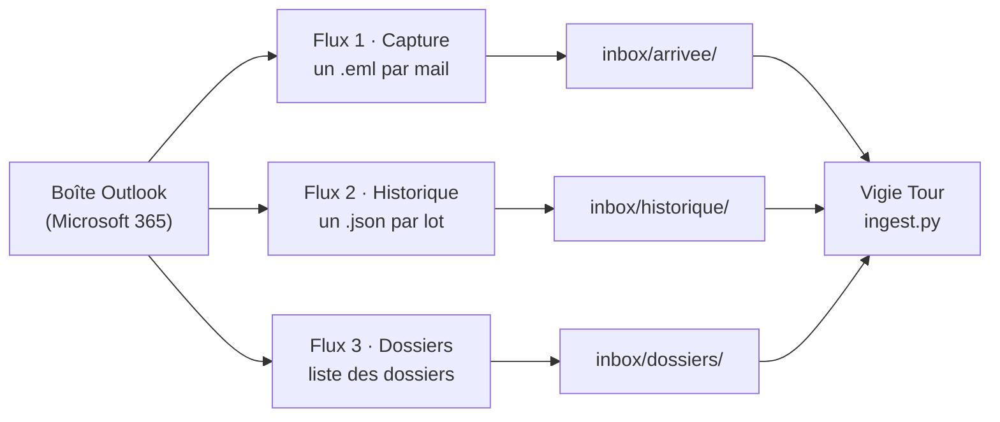

# Flux Power Automate

Vigie Tour ne se connecte jamais directement à votre messagerie. Ce sont des **flux Power Automate** qui tournent sous votre propre compte Microsoft 365 et déposent les mails sous forme de fichiers dans un dossier synchronisé (OneDrive, par exemple). Vigie Tour surveille ce dossier toutes les 60 secondes.



Arborescence attendue (le dossier racine se règle avec `inbox_dir` dans `config.local.json`, ou la variable `VIGIE_INBOX`) :

```
<inbox_dir>/
├── arrivee/      capture continue : mail-<horodatage>.eml
├── historique/   rattrapage : historique-<n>.json, sent-historique-<n>.json
└── dossiers/     dossiers-<date>.json
```

> Les noms exacts des actions peuvent varier selon la langue de votre tenant et les connecteurs activés par votre administrateur. Les flux ci-dessous sont décrits de façon générique : adaptez-les à votre environnement.

## Flux 1 · Capture continue (`arrivee/`)

Un fichier `.eml` par mail reçu ou envoyé, dès qu'il arrive.

| Étape | Action Power Automate | Réglage |
| --- | --- | --- |
| Déclencheur | Office 365 Outlook : *Lorsqu'un nouvel e-mail arrive (V3)* | Dossier : Boîte de réception. Option « Inclure les pièces jointes » inutile : Vigie Tour ne lit que le texte. |
| 1 | Office 365 Outlook : *Exporter l'e-mail (V2)* | Identifiant du message : celui du déclencheur. |
| 2 | OneDrive (ou SharePoint) : *Créer un fichier* | Dossier : `<inbox_dir>/arrivee`. Nom : `mail-@{utcNow('yyyyMMddHHmmss')}-@{rand(1000,9999)}.eml`. Contenu : sortie de l'étape 1. |

Pour que vos réponses soient aussi lues (engagements, attentes), créez un **second flux identique** avec le déclencheur *Lorsqu'un nouvel e-mail est envoyé (V3)* et le même dossier de sortie. Vigie Tour reconnaît un mail envoyé par l'adresse d'expéditeur (`me.email`).

## Flux 2 · Rattrapage de l'historique (`historique/`)

Un flux **manuel**, lancé une fois (ou de temps en temps) pour importer les mails des semaines passées. Il produit des fichiers `.json` contenant un tableau `value` d'objets au format Microsoft Graph.

| Étape | Action Power Automate | Réglage |
| --- | --- | --- |
| Déclencheur | Déclencheur manuel | |
| 1 | Office 365 Outlook : *Obtenir les e-mails (V3)* (ou *Envoyer une requête HTTP* vers Microsoft Graph, `GET /me/messages`) | Dossier, filtre de dates, nombre maximal de mails. Avec Graph, demandez aussi `conversationId`, `webLink` et `parentFolderId`. |
| 2 | OneDrive : *Créer un fichier* | Dossier : `<inbox_dir>/historique`. Nom : `historique-<n>.json` (ou `sent-historique-<n>.json` pour les éléments envoyés : le préfixe `sent-` indique à Vigie Tour qu'il s'agit du dossier « Éléments envoyés »). Contenu : la sortie de l'étape 1. |

Champs lus par Vigie Tour dans chaque mail (tous facultatifs sauf l'identifiant) :

| Champ | Usage |
| --- | --- |
| `internetMessageId` (sinon `id`) | Identifiant unique du message |
| `from.emailAddress.{name,address}` | Expéditeur |
| `toRecipients`, `ccRecipients` | Destinataires (« à moi », « en copie ») |
| `subject` | Objet, détection des tickets et des rapports automatiques |
| `receivedDateTime` / `sentDateTime` | Date |
| `body.content` / `bodyPreview` | Corps (HTML converti en texte, citations et signatures retirées) |
| `hasAttachments` | Mention « pièce jointe » |
| `conversationId` | Rattachement des réponses au bon fil |
| `webLink` | Bouton « Ouvrir dans Outlook » |
| `parentFolderId` | Dossier Outlook (nom résolu grâce au flux 3) |
| `internetMessageHeaders` | `List-Unsubscribe`, `Precedence`, `Auto-Submitted` : détection des newsletters et envois automatiques |
| `isDraft` | Les brouillons sont ignorés |

## Flux 3 · Liste des dossiers (`dossiers/`)

Facultatif : permet d'afficher le nom des dossiers Outlook (au lieu d'un identifiant) et de choisir, dans les réglages, quels dossiers surveiller ou ignorer.

| Étape | Action Power Automate | Réglage |
| --- | --- | --- |
| Déclencheur | Récurrence (une fois par jour) ou manuel | |
| 1 | *Envoyer une requête HTTP* vers Microsoft Graph | `GET /me/mailFolders?$top=100&$expand=childFolders` |
| 2 | OneDrive : *Créer un fichier* | Dossier : `<inbox_dir>/dossiers`. Nom : `dossiers-@{utcNow('yyyyMMdd')}.json`. Contenu : la sortie de l'étape 1. |

Vigie Tour lit le fichier `dossiers-*.json` le plus récent : un objet `{"value": [{"id", "displayName", "childFolders": [...]}]}`, et reconstitue des chemins du type `Projets / Nova Summit`. Les dossiers système (Courrier indésirable, Éléments supprimés, Brouillons, Archives…) sont ignorés par défaut.

## Bon à savoir

- **Fichiers en cours de synchronisation** : un fichier incomplet est simplement relu au passage suivant.
- **Doublons** : un mail déjà connu n'est jamais importé deux fois (identifié par son identifiant de message), même s'il arrive par la capture continue puis par l'historique ; l'historique complète alors `conversationId` et `webLink`.
- **Confidentialité** : les flux s'exécutent avec votre compte, les fichiers restent dans votre espace de stockage et Vigie Tour les lit localement. Vérifiez la politique de votre organisation avant de dupliquer des mails professionnels dans un dossier synchronisé.
- **Sans Power Automate** : n'importe quel outil capable de produire des `.eml` (export Outlook, script, règle de messagerie) peut alimenter `arrivee/`.
